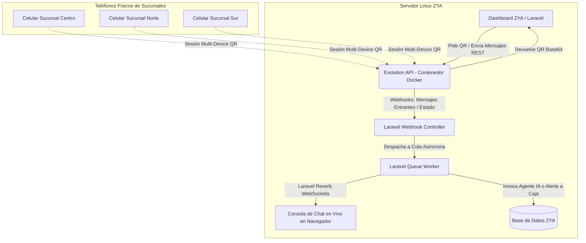

# Documento 2: Configuración de WhatsApp Multi-Sucursal por Código QR (Evolution API), Módulo de Conversaciones en Vivo, Roles y Plan de Integración

**Proyecto:** ZYA — Sistema de Control de Ventas, Inventario y Financiamiento  
**Módulo:** Integración con WhatsApp Web Multi-Device por QR (Microservicio Evolution API), Agentes IA y Consola de Conversaciones en Vivo  
**Versión de Documentación:** 2.0 (Arquitectura QR Multi-Sucursal sin costos por mensaje de Meta)  
**Fecha:** Octubre 2026  

---

## 1. Visión General: Por Qué el Enfoque QR Multi-Sucursal es Superior para ZYA

El modelo de cobranza y atención por **Código QR (WhatsApp Web Multi-Device)** sustituye la API de Meta Cloud por un microservicio local desacoplado (**Evolution API**), brindando ventajas determinantes para el modelo de negocio de ZYA:

| Criterio | API Oficial de Meta Cloud | WhatsApp por Código QR (Evolution API) |
|---|---|---|
| **Costo por Mensaje / Plantilla** | ~$0.015 a $0.035 USD por conversación (~$0.30 - $0.70 MXN). | **$0.00 MXN (100% Gratis e ilimitado).** |
| **Línea Telefónica Utilizada** | Línea virtual "limpia" (no puede estar en la app física de WhatsApp). | **El teléfono físico actual de cada sucursal de ZYA** con sus contactos y chats históricos. |
| **Restricción de Ventana (24 hrs)** | Estricta: si pasan 24 hrs, solo se pueden mandar plantillas aprobadas. | **Sin restricciones:** Puedes enviar mensajes libres en el día 1, 5 o 30 de atraso. |
| **Aprobación de Plantillas (HSM)** | Obligatoria y tardada ante Meta Business Suite. | **Cero plantillas:** La IA redacta mensajes dinámicos y personalizados al instante. |
| **Identidad Local de Sucursal** | Un solo número global para toda la empresa. | **Cada sucursal tiene su propio número y foto de perfil:** El cliente de Sucursal Centro habla con Sucursal Centro. |
| **Trámites y Verificaciones** | Exige verificación legal de empresa con Meta (actas, RFC, facturas). | **Cero burocracia:** Se despliega en el servidor y se escanea el QR en 2 minutos. |

---

## 2. Arquitectura del Microservicio (Docker + Evolution API)

Para gestionar las sesiones de WhatsApp de todas las sucursales sin sobrecargar a Laravel, se ejecuta **Evolution API v2** en un contenedor Docker en el mismo servidor de ZYA:



### 2.1 Archivo `docker-compose.yml` para el Servidor
Crear en el servidor (ej. `/home/zowor/docker/evolution-api/docker-compose.yml`):

```yaml
version: '3.8'

services:
  evolution-api:
    image: atendai/evolution-api:v2.1.1
    container_name: zya_evolution_api
    restart: always
    ports:
      - "8085:8085"
    environment:
      - SERVER_URL=http://localhost:8085
      - AUTHENTICATION_API_KEY=zya_secret_evolution_key_2026_xyz
      - DATABASE_ENABLED=true
      - DATABASE_CONNECTION_URI=sqlite:///evolution.db
      - DELAY_IGNORE_GROUPS=true
      - WEBHOOK_GLOBAL_ENABLED=true
      - WEBHOOK_GLOBAL_URL=http://127.0.0.1:8000/api/whatsapp/webhook
      - WEBHOOK_EVENTS_MESSAGES_UPSERT=true
      - WEBHOOK_EVENTS_CONNECTION_UPDATE=true
    volumes:
      - evolution_instances:/evolution/instances
      - evolution_store:/evolution/store

volumes:
  evolution_instances:
  evolution_store:
```

*Comando de arranque:* `docker compose up -d`  
*Consumo estimado:* ~180MB RAM en reposo (extremadamente ligero).

---

## 3. Matriz de Roles, Permisos y Ámbito por Sucursal (`Branch Scoping`)

El sistema ZYA utiliza [`spatie/laravel-permission`](file:///home/zowor/Proyectos/zya/composer.json#L23) con el modelo [`Permission`](file:///home/zowor/Proyectos/zya/app/Models/Permission.php) (`display_name` y `group_name`).

### 3.1 Permisos del Módulo (`group_name: whatsapp`)

| Permiso (`name`) | Nombre Amigable (`display_name`) | Descripción y Alcance |
|---|---|---|
| `whatsapp.menu` | WhatsApp: Acceso al Menú | Permite visualizar la sección de WhatsApp / Cobranza en la barra lateral. |
| `whatsapp.read` | WhatsApp: Consultar Conversaciones | Permite ver el historial de mensajes, estados y comprobantes recibidos. |
| `whatsapp.send_manual` | WhatsApp: Enviar Mensajes Manuales | Permite al personal enviar respuestas manuales o entablar chat directo con el cliente. |
| `whatsapp.pause_ai` | WhatsApp: Pausar / Reanudar IA | Permite apagar temporalmente las respuestas automáticas de la IA para un cliente. |
| `whatsapp.connect_qr` | WhatsApp: Vincular Celular por QR | Permite al cajero/encargado generar y escanear el QR para conectar el teléfono de su tienda. |
| `whatsapp.notes` | WhatsApp: Registrar Notas Internas | Permite escribir notas de seguimiento privado dentro del expediente del chat. |
| `whatsapp.promises.manage` | WhatsApp: Gestionar Promesas de Pago | Permite editar, reprogramar o cancelar promesas de pago registradas por la IA. |
| `whatsapp.all_branches` | WhatsApp: Ver Todas las Sucursales | Permite a directores y auditores ver conversaciones y comprobantes de toda la empresa. Sin este permiso, el usuario **solo ve los chats y el QR de su propia sucursal** (`branch_id`). |

---

### 3.2 Migración de Permisos y Campos de Sucursal

**Migración para la tabla `branches` (`add_whatsapp_fields_to_branches_table`):**
```php
Schema::table('branches', function (Blueprint $table) {
    $table->string('whatsapp_instance_name')->nullable()->after('name');
    $table->string('whatsapp_phone_number')->nullable()->after('whatsapp_instance_name');
    $table->enum('whatsapp_status', ['disconnected', 'connecting', 'connected'])->default('disconnected')->after('whatsapp_phone_number');
    $table->timestamp('whatsapp_connected_at')->nullable()->after('whatsapp_status');
});
```

**Migración de Permisos (`create_whatsapp_permissions`):**
```php
use App\Models\Permission;
use Spatie\Permission\Models\Role;

$permissions = [
    ['name' => 'whatsapp.menu',            'display_name' => 'WhatsApp > Acceso al Menú',                 'group_name' => 'whatsapp'],
    ['name' => 'whatsapp.read',            'display_name' => 'WhatsApp > Ver Conversaciones',              'group_name' => 'whatsapp'],
    ['name' => 'whatsapp.send_manual',     'display_name' => 'WhatsApp > Enviar Mensajes Manuales',       'group_name' => 'whatsapp'],
    ['name' => 'whatsapp.pause_ai',        'display_name' => 'WhatsApp > Pausar / Reanudar IA',           'group_name' => 'whatsapp'],
    ['name' => 'whatsapp.connect_qr',      'display_name' => 'WhatsApp > Vincular Celular por QR',        'group_name' => 'whatsapp'],
    ['name' => 'whatsapp.notes',           'display_name' => 'WhatsApp > Registrar Notas Internas',       'group_name' => 'whatsapp'],
    ['name' => 'whatsapp.promises.manage', 'display_name' => 'WhatsApp > Gestionar Promesas de Pago',      'group_name' => 'whatsapp'],
    ['name' => 'whatsapp.all_branches',    'display_name' => 'WhatsApp > Acceso a Todas las Sucursales',    'group_name' => 'whatsapp'],
];

foreach ($permissions as $p) {
    Permission::firstOrCreate(['name' => $p['name'], 'guard_name' => 'web'], $p);
}
```

---

## 4. Servicio de Conexión en Laravel (`EvolutionWhatsAppService`)

Este servicio encapsula todas las llamadas REST al microservicio de Evolution API:

```php
namespace App\Services\Cobranza;

use Illuminate\Support\Facades\Http;
use Illuminate\Support\Facades\Log;

class EvolutionWhatsAppService
{
    protected string $baseUrl;
    protected string $apiKey;

    public function __construct()
    {
        $this->baseUrl = config('services.evolution.base_url', 'http://127.0.0.1:8085');
        $this->apiKey = config('services.evolution.api_key');
    }

    /**
     * Crear una instancia para la sucursal si no existe
     */
    public function createInstance(string $instanceName): array
    {
        $url = "{$this->baseUrl}/instance/create";

        $response = Http::withHeaders(['apikey' => $this->apiKey])->post($url, [
            'instanceName' => $instanceName,
            'token' => md5($instanceName . config('app.key')),
            'qrcode' => true,
        ]);

        return $response->json();
    }

    /**
     * Solicitar el Código QR en Base64 para mostrar en pantalla
     */
    public function getQrCode(string $instanceName): ?string
    {
        $url = "{$this->baseUrl}/instance/connect/{$instanceName}";

        $response = Http::withHeaders(['apikey' => $this->apiKey])->get($url);

        if ($response->successful()) {
            return $response->json('base64'); // Imagen en base64 lista para 
        }

        return null;
    }

    /**
     * Consultar el estado de la conexión de la sucursal ('open', 'close', 'connecting')
     */
    public function getConnectionStatus(string $instanceName): string
    {
        $url = "{$this->baseUrl}/instance/connectionState/{$instanceName}";

        $response = Http::withHeaders(['apikey' => $this->apiKey])->get($url);

        return $response->json('instance.state') ?? 'disconnected';
    }

    /**
     * Enviar mensaje de texto con simulación humana (composing delay)
     */
    public function sendTextMessage(string $instanceName, string $toPhoneE164, string $textMessage): array
    {
        $url = "{$this->baseUrl}/message/sendText/{$instanceName}";

        $response = Http::withHeaders(['apikey' => $this->apiKey])->post($url, [
            'number' => $toPhoneE164,
            'text' => $textMessage,
            'delay' => rand(1500, 3500), // Simula que el asesor/IA está escribiendo entre 1.5 y 3.5 segundos
            'presence' => 'composing'
        ]);

        return $response->json();
    }

    /**
     * Cerrar sesión / Desvincular teléfono de la sucursal
     */
    public function logout(string $instanceName): bool
    {
        $url = "{$this->baseUrl}/instance/logout/{$instanceName}";
        $response = Http::withHeaders(['apikey' => $this->apiKey])->delete($url);
        return $response->successful();
    }
}
```

---

## 5. Módulo de Vinculación por Código QR en el Dashboard

Cada sucursal cuenta con su propia pantalla de estado en el Dashboard de ZYA (`/whatsapp/conexion`):

### 5.1 Flujo Visual del Encargado de Sucursal
1. Entra a la sección **WhatsApp Sucursal**.
2. Si la línea está **Desconectada** (Semáforo Rojo):
   * Presiona el botón **"Generar Código QR"**.
   * El sistema genera una llamada AJAX a `EvolutionWhatsAppService::getQrCode()` y proyecta el QR en el modal.
3. El cajero toma el teléfono físico de la tienda, abre WhatsApp $\rightarrow$ *Dispositivos vinculados* $\rightarrow$ Escanea la pantalla.
4. El WebSocket detecta la conexión y cambia automáticamente el indicador a **"Conectado y Listo"** (Semáforo Verde), mostrando el número de teléfono vinculado y la fecha de enlace.

---

## 6. Arquitectura del Webhook para Mensajes Entrantes

Cuando un cliente escribe al número de la tienda, Evolution API envía un webhook inmediato a Laravel:

### 6.1 Controlador de Webhook (`app/Http/Controllers/Api/WhatsAppWebhookController.php`)

```php
namespace App\Http\Controllers\Api;

use App\Http\Controllers\Controller;
use App\Jobs\ProcessWhatsAppWebhookJob;
use Illuminate\Http\Request;
use Illuminate\Support\Facades\Log;

class WhatsAppWebhookController extends Controller
{
    public function handle(Request $request)
    {
        // 1. Validar la API Key de Evolution API
        $apiKey = $request->header('apikey');
        if ($apiKey !== config('services.evolution.api_key')) {
            return response()->json(['error' => 'No autorizado'], 401);
        }

        $payload = $request->all();
        $event = $payload['event'] ?? null;
        $instance = $payload['instance'] ?? null;

        // 2. Si es actualización del estado de conexión (conexión/desconexión)
        if ($event === 'connection.update') {
            $state = $payload['data']['state'] ?? 'disconnected';
            \App\Models\Branch::where('whatsapp_instance_name', $instance)->update([
                'whatsapp_status' => ($state === 'open') ? 'connected' : 'disconnected'
            ]);
            return response()->json(['status' => 'CONNECTION_UPDATED'], 200);
        }

        // 3. Si es un mensaje entrante de un cliente
        if ($event === 'messages.upsert' && !($payload['data']['key']['fromMe'] ?? false)) {
            ProcessWhatsAppWebhookJob::dispatch($payload)->onQueue('whatsapp-high');
        }

        return response()->json(['status' => 'PROCESSED'], 200);
    }
}
```

---

## 7. Políticas de Seguridad Anti-Baneo (Reglas de Oro)

Para garantizar **cero bloqueos de números** al operar con WhatsApp Web multi-dispositivo, el sistema aplica las siguientes salvaguardas automáticas:

1. **Simulación de Comportamiento Humano (*Human Typing Presence*):**
   * Antes de cada entrega, el microservicio envía a WhatsApp el estado `"escribiendo..."` durante un tiempo proporcional al largo del texto (entre 2 y 5 segundos).
2. **Espaciado Inteligente entre Envíos Masivos (*Throttle Rate Limiting*):**
   * El comando de cobranza matutina **nunca** dispara 50 mensajes simultáneos.
   * Utiliza la cola de Laravel con retraso progresivo:  
     `$job->delay(now()->addSeconds($index * rand(25, 55)))`  
     *Resultado:* Entre cada mensaje saliente de una sucursal transcurren entre 25 y 55 segundos aleatorios, replicando el ritmo de un empleado humano.
3. **Variabilidad Dinámica del Saludo con IA:**
   * La IA nunca envía el mismo texto idéntico dos veces seguidas. Varía sinónimos, estructura del saludo y cordialidad para evitar patrones robóticos detectables por los algoritmos de spam de Meta.
4. **Respeto Estricto de Horarios Legales:**
   * El motor de envíos bloquea automáticamente cualquier intento de contacto antes de las 08:30 AM o después de las 20:30 PM (hora centro de México).

---

## 8. Arquitectura del Módulo de Conversaciones en Vivo y Laravel Reverb

### 8.1 Esquema de Base de Datos

```sql
-- Hilo de conversación por cliente y sucursal
CREATE TABLE whatsapp_conversations (
    id BIGINT PRIMARY KEY AUTO_INCREMENT,
    customer_id BIGINT NOT NULL,
    branch_id BIGINT NOT NULL,
    phone VARCHAR(20) NOT NULL,
    ai_status ENUM('ai_active', 'escalated_waiting', 'human_active', 'resolved') DEFAULT 'ai_active',
    assigned_user_id BIGINT NULL,
    last_interaction_at TIMESTAMP NULL,
    created_at TIMESTAMP, updated_at TIMESTAMP,
    FOREIGN KEY (customer_id) REFERENCES customers(id),
    FOREIGN KEY (branch_id) REFERENCES branches(id),
    FOREIGN KEY (assigned_user_id) REFERENCES users(id)
);

-- Mensajes de texto y multimedia
CREATE TABLE whatsapp_messages (
    id BIGINT PRIMARY KEY AUTO_INCREMENT,
    conversation_id BIGINT NOT NULL,
    message_id VARCHAR(100) UNIQUE,
    direction ENUM('inbound', 'outbound'),
    sender_type ENUM('ai_agent', 'human_agent', 'customer'),
    user_id BIGINT NULL,
    message_type ENUM('text', 'image', 'document'),
    content TEXT NULL,
    media_path VARCHAR(255) NULL,
    created_at TIMESTAMP, updated_at TIMESTAMP,
    FOREIGN KEY (conversation_id) REFERENCES whatsapp_conversations(id),
    FOREIGN KEY (user_id) REFERENCES users(id)
);

-- Notas internas privadas de los cajeros/gestores
CREATE TABLE whatsapp_internal_notes (
    id BIGINT PRIMARY KEY AUTO_INCREMENT,
    conversation_id BIGINT NOT NULL,
    user_id BIGINT NOT NULL,
    note TEXT NOT NULL,
    created_at TIMESTAMP, updated_at TIMESTAMP,
    FOREIGN KEY (conversation_id) REFERENCES whatsapp_conversations(id),
    FOREIGN KEY (user_id) REFERENCES users(id)
);
```

### 8.2 Controlador de la Consola de Chat (`WhatsAppConversationController.php`)

```php
namespace App\Http\Controllers\Dashboard;

use App\Http\Controllers\Controller;
use App\Models\WhatsAppConversation;
use App\Models\WhatsAppMessage;
use App\Models\WhatsAppInternalNote;
use App\Services\Cobranza\EvolutionWhatsAppService;
use Illuminate\Http\Request;
use Carbon\Carbon;

class WhatsAppConversationController extends Controller
{
    public function __construct()
    {
        $this->middleware('permission:whatsapp.menu|whatsapp.read');
        $this->middleware('permission:whatsapp.send_manual')->only(['sendMessage']);
        $this->middleware('permission:whatsapp.pause_ai')->only(['toggleAi']);
        $this->middleware('permission:whatsapp.notes')->only(['storeNote']);
    }

    public function index(Request $request)
    {
        $query = WhatsAppConversation::with(['customer', 'latestMessage', 'assignedUser', 'branch']);

        // Aislamiento por sucursal
        if (auth()->check() && !auth()->user()->can('whatsapp.all_branches')) {
            $query->where('branch_id', auth()->user()->branch_id);
        } elseif ($branchId = $request->input('branch_id')) {
            $query->where('branch_id', $branchId);
        }

        if ($status = $request->input('status')) {
            $query->where('ai_status', $status);
        }

        $conversations = $query->orderByDesc('last_interaction_at')->paginate(20);

        return view('whatsapp.inbox', compact('conversations'));
    }

    public function show(int $id)
    {
        $conversation = WhatsAppConversation::with([
            'customer', 
            'messages', 
            'notes.user', 
            'branch'
        ])->findOrFail($id);

        if (!auth()->user()->can('whatsapp.all_branches') && $conversation->branch_id !== auth()->user()->branch_id) {
            abort(403, 'No tienes permiso para consultar chats de otra sucursal.');
        }

        return view('whatsapp.show', compact('conversation'));
    }

    public function sendMessage(Request $request, int $id, EvolutionWhatsAppService $evolutionService)
    {
        $request->validate(['message' => 'required|string|max:1500']);

        $conversation = WhatsAppConversation::with('branch')->findOrFail($id);
        $instanceName = $conversation->branch->whatsapp_instance_name;

        // Enviar vía la instancia específica de la sucursal
        $response = $evolutionService->sendTextMessage($instanceName, $conversation->phone, $request->input('message'));

        if (!empty($response['key']['id'])) {
            WhatsAppMessage::create([
                'conversation_id' => $conversation->id,
                'message_id' => $response['key']['id'],
                'direction' => 'outbound',
                'sender_type' => 'human_agent',
                'user_id' => auth()->id(),
                'message_type' => 'text',
                'content' => $request->input('message'),
            ]);

            $conversation->update([
                'last_interaction_at' => Carbon::now(),
                'ai_status' => 'human_active',
                'assigned_user_id' => auth()->id()
            ]);

            return redirect()->back()->with('success', 'Mensaje enviado.');
        }

        return redirect()->back()->with('error', 'Error al entregar el mensaje al celular de la sucursal.');
    }

    public function toggleAi(Request $request, int $id)
    {
        $conversation = WhatsAppConversation::findOrFail($id);

        $newStatus = ($conversation->ai_status === 'ai_active') ? 'human_active' : 'ai_active';
        $assignedUser = ($newStatus === 'human_active') ? auth()->id() : null;

        $conversation->update([
            'ai_status' => $newStatus,
            'assigned_user_id' => $assignedUser
        ]);

        $msg = ($newStatus === 'ai_active') ? 'IA reanudada para este chat.' : 'IA pausada. Estás a cargo de la conversación.';
        return redirect()->back()->with('success', $msg);
    }

    public function storeNote(Request $request, int $id)
    {
        $request->validate(['note' => 'required|string|max:1000']);

        WhatsAppInternalNote::create([
            'conversation_id' => $id,
            'user_id' => auth()->id(),
            'note' => $request->input('note'),
        ]);

        return redirect()->back()->with('success', 'Nota interna registrada.');
    }
}
```

---

## 9. Plan de Trabajo e Integración por Fases

| Fase | Duración Estimada | Entregables Principales |
|---|---|---|
| **Fase 1: Despliegue de Microservicio Docker & Permisos** | Semana 1 | - Levantamiento de Evolution API en Docker (`ports: 8085`).<br>- Migración de campos en `branches` y tabla de permisos `whatsapp.*`.<br>- Pantalla de escaneo de QR en el Dashboard de ZYA. |
| **Fase 2: Enlace de Sucursales y Webhooks** | Semana 1 - 2 | - Vinculación de los celulares físicos de las tiendas mediante escaneo de QR.<br>- Webhook en Laravel recibiendo mensajes entrantes y actualizando estados de conexión.<br>- Despacho a colas asíncronas con Laravel Queue. |
| **Fase 3: Motor de Envíos y Reglas Anti-Baneo** | Semana 2 - 3 | - Implementación de `EvolutionWhatsAppService` con simulación humana y rate limiting aleatorio.<br>- Comando Artisan `cobranza:evaluar-vencimientos` integrado con el Scheduler diario de ZYA.<br>- Normalización de teléfonos a E.164 en la base de datos. |
| **Fase 4: Agente Conversacional IA & Laravel Reverb** | Semana 3 - 4 | - Integración del LLM para diálogo empático, resolución de objeciones y promesas de pago.<br>- WebSockets con Laravel Reverb para ver la llegada de mensajes en vivo en la pantalla del cajero.<br>- Recepción y resguardo de comprobantes para revisión humana en caja. |
| **Fase 5: Consola de Chat Web & Pruebas en Vivo** | Semana 5 | - Consola de chat estilo WhatsApp Web con panel lateral de adeudos, notas internas y pausa de IA.<br>- Pruebas piloto con números de sucursal reales.<br>- Capacitación a los cajeros y encargados de tienda. |
